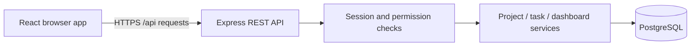

# Architecture proposal

Status: architecture, listed libraries and M1 implementation/installations approved. M2 feature implementation is not yet approved. Prepared 24 October 2026.
Approved constraints and features are recorded in PROJECT-PLAN.md and REQUIREMENTS.md. Installed versions are recorded in package-lock.json.

## Application boundaries

One repository: smart-task-project-management-system, public when separately approved. npm workspaces containing frontend/ and backend/. Keep HTTP handlers thin, business rules in services, database access explicit, and validation at request boundaries. Avoid generic base repositories, dependency injection frameworks and microservices for this prototype.

During development Vite proxies /api to Express. For a proposed Vercel deployment, the frontend serves the browser app and proxies /api to a separate Express deployment; the browser uses one origin. Verify rewrites, cookie forwarding and CSRF behavior on an early deployment before relying on this arrangement. Locally/containerized, Express remains a conventional Node server. Export app creation separately from the local listener for integration tests and function hosting.

## Proposed libraries and purpose

| Area          | Proposal                                       | Purpose                                                                  |
| ------------- | ---------------------------------------------- | ------------------------------------------------------------------------ |
| Frontend      | React, TypeScript, Vite                        | Responsive SPA and build tooling                                         |
| Navigation    | React Router                                   | Protected routes and page navigation                                     |
| Remote state  | TanStack Query                                 | API cache, invalidation, loading/error handling                          |
| Forms         | React Hook Form and Zod                        | Form state and runtime validation                                        |
| UI            | CSS modules/design tokens and semantic HTML    | Consistent accessible layout without an extra UI framework               |
| Charts        | Recharts                                       | Accessible supporting project progress visual; include text values       |
| API           | Express, TypeScript, Zod                       | REST routes, middleware and validated payloads                           |
| Persistence   | Prisma ORM with PostgreSQL                     | Typed queries and reviewed versioned SQL migrations                      |
| Sessions      | express-session, connect-pg-simple, pg         | PostgreSQL-backed sessions across instances                              |
| Passwords     | Node crypto scrypt                             | Salted, parameterized password hashing with timing-safe verification     |
| HTTP security | Helmet and explicit origin/CSRF checks         | Security headers and state-changing request protection                   |
| Logging       | Pino with redaction                            | Structured errors/request logs without credentials or cookie contents    |
| Tests         | Vitest, Supertest, Testing Library, Playwright | Business rules, real-database API integration, UI and browser workflows  |
| Quality       | ESLint, Prettier, TypeScript strict checks     | Consistency and static checks                                            |
| Automation    | GitHub Actions                                 | Install, checks, tests, build; isolated PostgreSQL service for API tests |
| Containers    | Dockerfiles and Compose                        | Reproducible frontend/backend/database run path                          |

Confirm currently supported mutually compatible versions before installation; use npm lockfiles and npm ci for reproduction. Prisma API/config differs across major versions; consult the selected version's documentation. Use a small bounded runtime connection pool and the provider's pooled connection where appropriate; migrations use a suitable direct database connection. Prisma connections and the session-store connection pool both count toward the database budget.

## Proposed schema

All IDs are UUIDs. Audit timestamps are UTC timestamptz. due_date is PostgreSQL DATE and crosses the API as YYYY-MM-DD, avoiding implicit browser UTC conversions.

| Entity       | Core fields and constraints                                                                                                                                      |
| ------------ | ---------------------------------------------------------------------------------------------------------------------------------------------------------------- |
| User         | id, name, normalized unique email, password_hash, role ADMIN/TEAM_MEMBER, created_at, updated_at                                                                 |
| Project      | id, name, description, created_by user FK, created_at, updated_at                                                                                                |
| Task         | id, title, description, project_id FK, assignee_id FK, status TODO/IN_PROGRESS/COMPLETED, priority LOW/MEDIUM/HIGH, due_date, created_by, created_at, updated_at |
| Session      | session ID, serialized session data, expiry; compatible with session store                                                                                       |
| Notification | id, recipient_id FK, task_id FK, due_date_snapshot, kind OVERDUE, read_at, created_at; unique recipient/task/deadline/kind                                       |

Project FK deletion is RESTRICT, providing the approved protection even under concurrent requests. Task deletion removes task-specific notifications. User deletion and role management UI are outside the requested scope unless separately approved. Add indexes matching measured query patterns: project/status/assignee/due date and notification recipient/read state. Enforce relationships and unique email in the database as well as validation.

## API and permission proposal

| Routes                                                    | Permission                                                             |
| --------------------------------------------------------- | ---------------------------------------------------------------------- |
| POST /api/auth/register, /login                           | Public, throttled; registration always creates Team Member             |
| GET /api/auth/csrf                                        | Issue session-bound CSRF token; do not cache                           |
| POST /api/auth/logout; GET /api/auth/me                   | Authenticated; logout destroys stored session and clears cookie        |
| GET /api/projects, /api/projects/:id                      | Both roles                                                             |
| POST /api/projects; PATCH/DELETE /api/projects/:id        | Admin                                                                  |
| GET /api/tasks, /api/tasks/:id                            | Both roles                                                             |
| POST /api/tasks; PATCH/DELETE /api/tasks/:id              | Admin                                                                  |
| PATCH /api/tasks/:id/status                               | Admin or assigned member; member can supply status only                |
| GET /api/users/assignees                                  | Admin; minimal id/name list for assignment                             |
| GET /api/dashboard                                        | Both roles; shared-workspace totals                                    |
| GET /api/notifications; PATCH /api/notifications/:id/read | Own notifications only                                                 |
| GET /api/health                                           | Minimal public liveness response; no secrets or infrastructure details |

List tasks supports project, status, priority, assignee, proposed text search, page/pageSize, and allowlisted sorting. Bound page size and define deterministic ordering. Produce OpenAPI documentation with example requests, responses, cookies/CSRF and error cases. Error format: { error: { code, message, fields? } }; no production stack traces. Use HTTP 400 for invalid input, 401 unauthenticated, 403 forbidden, 404 missing resources, 409 conflicts, and 429 throttling.

## Security design

Regenerate the session at login; store only necessary identity data, verify authorization server-side on every request, and invalidate sessions on logout. No role field accepted by registration. Initial Admin creation is an explicit setup command using local environment/input, never a public endpoint or a committed production password.

Use an HttpOnly cookie, Secure in HTTPS environments, SameSite=Lax, explicit expiry and bounded session lifetime. Keep app/API same-origin through proxying. Require a session-bound CSRF token and validate request origin for state-changing browser requests, including auth endpoints; rotate relevant tokens when sessions regenerate. Disable authenticated response caching. Configure trusted proxies narrowly for the chosen hosting path and test spoofed forwarding headers.

Use parameterized ORM queries, request size limits, strict field allowlists, validation and database constraints. Use a PostgreSQL-backed or equivalent shared limiter for login/register; do not rely solely on per-process counters in function hosting. Return generic login failures. Record structured logs with secrets/passwords/cookies redacted. No production secrets in source, README, seed files, logs, screenshots or frontend build variables. Public demonstration data must be fictional. Demo credentials/access policy is a separate approval before deployment.

## Business calculations and notifications

Get the current calendar date explicitly in Asia/Dhaka on the server. Task is overdue when due_date < today's Bangladesh date and status != COMPLETED. Due today is not overdue. Pending = TODO + IN_PROGRESS (proposal awaiting confirmation). Project progress = completed tasks / all tasks; empty project shows 0% with an explicit no-tasks state. Dashboard aggregates and filtered lists must agree with the shared-workspace visibility rules.

Proposed recipients: assigned member for their overdue tasks, Admins for all overdue tasks. Synchronize lazily on authenticated app activity and periodically while the tab is active, never in an unawaited function background timer. Use database upsert/unique constraints for deduplication. Proposed behavior: list only currently overdue relevant notices, retain stored read state for the same task/deadline, create a new notice for a newly overdue changed deadline, and remove old assignee notifications on reassignment. Notify only the new assignee on their next synchronization. Approve these details before implementation.

## Verification and release

- Unit tests: strict calendar validation, Dhaka midnight boundary, pending/overdue calculations, permission decisions, and zero-task progress.
- Database/API tests against disposable PostgreSQL: CRUD, FK protection, invalid filters, duplicate email, no privilege escalation, assigned member field restrictions, session fixation/logout, CSRF failures and notification ownership/deduplication.
- Browser tests: register/login/logout, Admin project/task workflow, member status update, filters, dashboard and unread indicator. Test loading/error/empty states and mobile keyboard usability manually where automation adds little value.
- CI: clean install, formatting/lint, typecheck, migrations on an empty test database, tests and production builds. Smoke-test containers and the final deployed application.
- Real commits per coherent working increment, no backdating; deployment and pushing remain separately gated. Migration failures must not trigger destructive reset of an existing database.

## Reference documentation checked during planning

- React TypeScript: https://react.dev/learn/typescript
- Vite templates: https://vite.dev/guide/
- Express security: https://expressjs.com/advanced/best-practice-security/
- Prisma connection management: https://www.prisma.io/docs/orm/prisma-client/setup-and-configuration/databases-connections
- Playwright: https://playwright.dev/docs/running-tests

These sources support tool capabilities, not a claim that one stack is universal industry practice.
